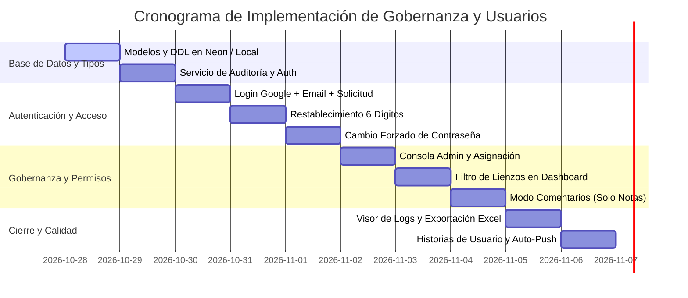

# Plan de Acción Integral: Gestión de Usuarios, Roles, Permisos por Lienzo, Acceso con Google y Logs de Auditoría

> **Documento:** Plan de Acción Oficial de Seguridad y Gobernanza de ProcesStudio  
> **Versión:** 1.0.0 | **Fecha:** 2026-10-28  
> **Alineación Normativa:** Directivas Obligatorias de Desarrollo (`AGENTS.md` y `.agents/rules/directivas.md`), Estándar BPMN 2.0 (ISO/IEC 19510), Gestión de Calidad ISO 9001:2015 (Control de Cambios y Trazabilidad) y Seguridad de la Información ISO/IEC 27001 (Control de Accesos).  
> **Historias de Usuario:** `PST-069`, `PST-070`, `PST-071`, `PST-072`, `PST-073`.

---

## 1. Visión y Objetivos del Sistema de Usuarios

El propósito fundamental de esta evolución es transformar **ProcesStudio** en una plataforma corporativa gobernada por **Control de Acceso Basado en Roles (RBAC)** y **Permisos Granulares por Lienzo (Lienzo / Proyecto)**, garantizando:

1. **Acceso Restringido y Gobernado:** Eliminación del auto-registro libre. Solo los usuarios debidamente habilitados por un **Administrador** pueden acceder a la plataforma. Los nuevos interesados dispondrán de un flujo de **Solicitud de Habilitación**.
2. **Identidad Corporativa y Google Sign-In:** Soporte dual para ingreso mediante correo electrónico y credenciales locales seguras, o a través de **Google OAuth 2.0 / Google Identity Services (GIS)** con verificación de dominio y estado de cuenta.
3. **Flujo Criptográfico de Restablecimiento de Contraseña (Código de 6 Dígitos):** Mecanismo de recuperación que genera un código temporal de 6 dígitos que sirve para ingresar y que obliga inmediatamente al cambio de contraseña con validación de fortaleza y confirmación.
4. **Permisos Granulares por Lienzo:** Capacidad del Administrador para asignar o desasignar proyectos a usuarios con tres niveles de control:
   - **Solo Lectura:** Inspección visual y exportación; edición bloqueada.
   - **Comentarios:** El usuario **únicamente puede interactuar con Notas Adhesivas (`StickyNote`)**, colocándolas y editándolas sobre el lienzo para sugerencias o revisiones, sin alterar en absoluto el flujo BPMN ni los carriles.
   - **Editor:** Autoridad completa para diseñar diagramas BPMN, gestionar carriles, compuertas, SLAs, IA y guardar versiones.
5. **Trazabilidad Absoluta y Logs de Auditoría (Exclusivo Administrador):** Registro inmutable en base de datos de cada interacción del sistema (inicios de sesión, comentarios, modificaciones, asignaciones, exportaciones y bajas), accesible exclusivamente por usuarios con rol Administrador.
6. **Preservación de la Arquitectura Portable (Zero-AppData):** Compatibilidad híbrida entre la nube (Neon PostgreSQL) y la ejecución portátil USB (`MiAppProcesos_USB/data/security_vault.json`).

---

## 2. Diagrama Conceptual de la Arquitectura

```
┌────────────────────────────────────────────────────────────────────────────────────────┐
│                                 PROCESSTUDIO AUTH & RBAC                               │
└───────────────────────────────────────────┬────────────────────────────────────────────┘
                                            │
                    ┌───────────────────────┴───────────────────────┐
                    ▼                                               ▼
         [ PANTALLA DE ACCESO ]                          [ ESTADO NO HABILITADO ]
    ├── Login Email + Contraseña                                    │
    ├── Botón Oficial "Login con Google"                            ▼
    ├── "Restablecer contraseña" ➔ Código 6 dígitos    [ Formulario de Solicitud ]
    └── "¿No tienes cuenta? Solicitar Habilitación" ──► Solicitar Habilitación al Admin
                                                                    │
                    ┌───────────────────────────────────────────────┘
                    ▼
     [ REVISIÓN DEL ADMINISTRADOR ]
     ├── Aprobar como 'ADMIN' o 'USER'
     └── Asignar Proyectos y Permisos Iniciales
                    │
         ┌──────────┴────────────────────────┐
         ▼                                   ▼
 ┌──────────────────────┐        ┌────────────────────────────────────────────────┐
 │  ROL ADMINISTRADOR   │        │                  ROL USUARIO                   │
 ├──────────────────────┤        ├────────────────────────────────────────────────┤
 │ • Consola Admin      │        │ • Dashboard filtrado (Solo lienzos asignados)  │
 │ • Solicitudes Pend.  │        │ • Nivel por Lienzo:                            │
 │ • Asignación Lienzos │        │   ├── 👁️ Solo Lectura: Ver y exportar          │
 │ • Logs de Auditoría  │        │   ├── 💬 Comentarios: SOLO Notas Adhesivas     │
 │ • Acceso a Todos los │        │   └── ✏️ Editor: Modelado BPMN y guardado      │
 │   Lienzos            │        └────────────────────────────────────────────────┘
 └──────────┬───────────┘
            │
            ▼
 ┌────────────────────────────────────────────────────────────────────────────────┐
 │                       REGISTRO CENTRALIZADO DE AUDITORÍA                       │
 │ 📜 Inmutable | Filtrable por Usuario, Lienzo y Fecha | Exportable a Excel/PDF  │
 └────────────────────────────────────────────────────────────────────────────────┘
```

---

## 3. Esquema de Base de Datos y Persistencia

Se añaden las estructuras de seguridad en **Neon PostgreSQL** (a través de `@neondatabase/serverless`) y se genera su correspondiente réplica en la bóveda local portable para uso fuera de línea.

### 3.1. DDL Relacional en Neon PostgreSQL (`scripts/auth_schema.sql`)

```sql
-- ============================================================================
-- PROCESSTUDIO - MÓDULO DE AUTENTICACIÓN, GOBERNANZA Y AUDITORÍA
-- ============================================================================

-- 1. Tabla de Usuarios del Sistema
CREATE TABLE IF NOT EXISTS app_users (
    id UUID PRIMARY KEY DEFAULT uuid_generate_v4(),
    email VARCHAR(255) NOT NULL UNIQUE,
    password_hash VARCHAR(255) NULL,             -- Nulo si el usuario solo usa Google OAuth
    full_name VARCHAR(150) NOT NULL,
    organization_unit VARCHAR(160) NOT NULL,
    role VARCHAR(20) NOT NULL DEFAULT 'USER' CHECK (role IN ('ADMIN', 'USER')),
    status VARCHAR(20) NOT NULL DEFAULT 'ACTIVE' CHECK (status IN ('ACTIVE', 'INACTIVE', 'BLOCKED')),
    google_id VARCHAR(100) NULL UNIQUE,
    avatar_url VARCHAR(500) NULL,
    reset_code VARCHAR(6) NULL,                   -- Código temporal de 6 dígitos
    reset_code_expires_at TIMESTAMPTZ NULL,       -- Expiración del código (15 minutos)
    must_change_password BOOLEAN NOT NULL DEFAULT FALSE,
    created_at TIMESTAMPTZ NOT NULL DEFAULT NOW(),
    updated_at TIMESTAMPTZ NOT NULL DEFAULT NOW()
);

-- 2. Solicitudes de Habilitación de Nuevas Cuentas (Sin auto-registro directo)
CREATE TABLE IF NOT EXISTS user_access_requests (
    id UUID PRIMARY KEY DEFAULT uuid_generate_v4(),
    email VARCHAR(255) NOT NULL UNIQUE,
    full_name VARCHAR(150) NOT NULL,
    organization_unit VARCHAR(160) NOT NULL,
    justification TEXT NOT NULL,
    status VARCHAR(20) NOT NULL DEFAULT 'PENDING' CHECK (status IN ('PENDING', 'APPROVED', 'REJECTED')),
    reviewed_by UUID REFERENCES app_users(id),
    reviewed_at TIMESTAMPTZ NULL,
    admin_notes TEXT NULL,
    created_at TIMESTAMPTZ NOT NULL DEFAULT NOW()
);

-- 3. Asignación Granular de Permisos por Lienzo (Proyecto)
CREATE TABLE IF NOT EXISTS project_user_permissions (
    id UUID PRIMARY KEY DEFAULT uuid_generate_v4(),
    user_id UUID NOT NULL REFERENCES app_users(id) ON DELETE CASCADE,
    project_file_name VARCHAR(120) NOT NULL,
    permission_level VARCHAR(20) NOT NULL CHECK (permission_level IN ('READ_ONLY', 'COMMENTS', 'EDITOR')),
    assigned_by UUID REFERENCES app_users(id),
    assigned_at TIMESTAMPTZ NOT NULL DEFAULT NOW(),
    UNIQUE(user_id, project_file_name)
);

-- 4. Registro Centralizado e Inmutable de Logs de Auditoría
CREATE TABLE IF NOT EXISTS audit_logs (
    id UUID PRIMARY KEY DEFAULT uuid_generate_v4(),
    timestamp TIMESTAMPTZ NOT NULL DEFAULT NOW(),
    user_id UUID NULL REFERENCES app_users(id),
    user_email VARCHAR(255) NOT NULL,
    user_role VARCHAR(20) NOT NULL,
    action_type VARCHAR(60) NOT NULL,
    target_resource VARCHAR(200) NULL,
    details JSONB NOT NULL DEFAULT '{}',
    ip_client VARCHAR(45) NULL
);

-- Índices de Rendimiento para Consultas de Auditoría y Filtros del Dashboard
CREATE INDEX IF NOT EXISTS idx_users_email ON app_users(email);
CREATE INDEX IF NOT EXISTS idx_users_role ON app_users(role);
CREATE INDEX IF NOT EXISTS idx_user_perms_user_id ON project_user_permissions(user_id);
CREATE INDEX IF NOT EXISTS idx_user_perms_project ON project_user_permissions(project_file_name);
CREATE INDEX IF NOT EXISTS idx_audit_logs_timestamp ON audit_logs(timestamp DESC);
CREATE INDEX IF NOT EXISTS idx_audit_logs_email ON audit_logs(user_email);
CREATE INDEX IF NOT EXISTS idx_audit_logs_action ON audit_logs(action_type);
```

### 3.2. Adaptador Portable USB Fuera de Línea (`SecurityStorageService`)
- Ubicación: `src/services/securityStorageService.ts`
- Respaldo: `MiAppProcesos_USB/data/security_vault.json`
- Funcionalidad: Si la aplicación no tiene conexión con Neon PostgreSQL (ejecución sin internet desde el pendrive), la sesión se valida contra la última copia local cifrada de usuarios y permisos. Los eventos de auditoría generados fuera de línea se guardan en una cola local (`audit_queue.json`) y se sincronizan de forma transparente con Neon en cuanto se restablece la conectividad.

---

## 4. Especificación Funcional de Componentes y Flujos

### 4.1. Flujo de Ingreso y Login con Google
1. **Modal de Autenticación (`AuthModal.tsx`):**
   - Campos: Correo electrónico y Contraseña.
   - Botón destacado con estilo oficial de Google: **"Continuar con Google"**.
   - Acceso con Google Identity Services (GIS) en web o mediante protocolo de autenticación seguro en Electron.
   - Enlace: *"¿Olvidaste tu contraseña? Restablecer contraseña"*.
   - Botón secundario: *"¿No tienes cuenta habilitada? Solicitar Habilitación"*.
2. **Validación de Identidad:**
   - Si el usuario se loguea por Google:
     - El token valida el correo (`email`) y su identificador (`google_id`).
     - Si el correo **existe y está ACTIVO** en `app_users`, se inicia la sesión y se registra `AUTH_LOGIN_GOOGLE` en los logs.
     - Si el correo **no está registrado o está pendiente**, el sistema bloquea el ingreso y muestra el mensaje: *"Tu correo no cuenta con habilitación activa en ProcesStudio. Por favor, solicita acceso a continuación."* completando automáticamente el formulario de solicitud con su nombre y correo de Google.

### 4.2. Flujo de "Solicitar Habilitación" (Cero Auto-Registro Libre)
1. **Modal `RequestAccessModal.tsx`:**
   - Formulario limpio y profesional:
     - Nombre y Apellido.
     - Correo electrónico institucional.
     - Unidad Organizativa / Dependencia.
     - Motivo o Justificación del requerimiento de acceso.
   - Al enviar:
     - Se registra en `user_access_requests` con estado `PENDING`.
     - Se dispara el evento de auditoría `ACCESS_REQUEST_SUBMITTED`.
     - El usuario recibe un mensaje de éxito: *"Tu solicitud de habilitación ha sido remitida al Administrador para su evaluación."*

### 4.3. Flujo de Restablecimiento de Contraseña (Código de 6 Dígitos)
1. **Solicitud de Código (`ForgotPasswordModal.tsx`):**
   - El usuario introduce su correo electrónico y presiona "Restablecer contraseña".
   - El sistema genera un código numérico aleatorio de 6 dígitos mediante generador criptográfico (`crypto.getRandomValues`).
   - Se almacena el código con un hash temporal, estableciendo `reset_code_expires_at = NOW() + INTERVAL '15 minutes'` y la bandera `must_change_password = true`.
   - Se presenta un diálogo seguro con el código de 6 dígitos generado (con opción de despacho por correo electrónico si se encuentra configurado el servicio transaccional).
   - Se registra el evento de auditoría `AUTH_RESET_CODE_ISSUED`.
2. **Ingreso con Código de 6 Dígitos:**
   - En la pantalla de login principal, el usuario ingresa su correo y el **código de 6 dígitos en el campo de contraseña**.
   - El backend/servicio valida que el código coincida y que la fecha actual no supere `reset_code_expires_at`.
   - Al validar el código, la aplicación **intercepta la sesión** y no permite abrir ningún proyecto ni ver el Dashboard habitual.
3. **Cambio Forzado Obligatorio (`ForcePasswordChangeModal.tsx`):**
   - Se abre un modal de pantalla bloqueante con los siguientes campos obligatorios:
     1. Código de 6 dígitos ingresado (para confirmación de posesión).
     2. Nueva Contraseña (mínimo 8 caracteres, alfanumérica).
     3. Confirmación de Nueva Contraseña.
   - Una vez validadas las reglas de seguridad, se calcula el nuevo `password_hash`, se anula el `reset_code`, se setea `must_change_password = false` y se registra `AUTH_PASSWORD_CHANGED` en la auditoría.
   - El usuario queda autenticado y es dirigido a su Dashboard de lienzos asignados.

---

## 5. Matriz de Roles y Gobernanza por Lienzo

### 5.1. Rol Administrador (`ADMIN`)
- **Visibilidad Global:** Acceso total a todos los lienzos de trabajo.
- **Consola de Administración (`AdminConsoleModal.tsx`)**:
  - **Pestaña Solicitudes de Habilitación:** Lista reactiva de pedidos con detalle de usuario, área y justificación. Botones "Aprobar como Usuario / Administrador" y "Rechazar con observaciones".
  - **Pestaña Usuarios del Sistema:** Alta manual, desactivación/reactivación de usuarios, reseteo forzado de contraseñas.
  - **Pestaña Asignación de Lienzos:** Matriz interactiva donde el Administrador selecciona un usuario y un lienzo, definiendo su nivel de permiso (`Solo Lectura`, `Comentarios`, `Editor`). Botón de desasignación instantánea.
  - **Pestaña Logs de Auditoría:** Visor centralizado y filtrable.

### 5.2. Rol Usuario (`USER`)
- **Dashboard Personalizado (`ProjectDashboard.tsx`):**
  - El listado de proyectos se filtra estrictamente para mostrar **únicamente los lienzos asignados al usuario por el Administrador**.
  - Si un usuario no tiene proyectos asignados, se le muestra un mensaje claro con botón para solicitar asignación de lienzos.
  - Cada tarjeta de proyecto exhibe una insignia con su nivel de permiso:
    - `[👁️ Solo Lectura]`
    - `[💬 Comentarios]`
    - `[✏️ Editor]`

### 5.3. Comportamiento del Lienzo según Nivel de Permiso

| Capacidad / Herramienta | 👁️ Solo Lectura | 💬 Comentarios | ✏️ Editor |
| :--- | :---: | :---: | :---: |
| Navegar y hacer zoom en el lienzo | ✅ Sí | ✅ Sí | ✅ Sí |
| Inspeccionar propiedades de actividades | ✅ Modo Lectura | ✅ Modo Lectura | ✅ Edición total |
| Arrastrar actividades BPMN (Tareas, Compuertas, Eventos) | ❌ Bloqueado | ❌ Bloqueado | ✅ Sí |
| Crear o modificar carriles funcionales (Swimlanes) | ❌ Bloqueado | ❌ Bloqueado | ✅ Sí |
| **Colocar y editar Notas Adhesivas (`StickyNote`)** | ❌ Bloqueado | **✅ HABILITADO** | ✅ Sí |
| Asignar nota a un nodo del proceso (`relatedNodeId`) | ❌ Bloqueado | **✅ HABILITADO** | ✅ Sí |
| Eliminar o modificar el flujo existente de proceso | ❌ Bloqueado | ❌ Bloqueado | ✅ Sí |
| Asistente de IA y Recomendaciones Radiales | ❌ Bloqueado | ❌ Bloqueado | ✅ Sí |
| Guardar cambios en el proyecto | ❌ Bloqueado | ✅ Guarda Notas | ✅ Guarda Todo |
| Exportar a PDF / PNG / Word / BPMN XML | ✅ Sí | ✅ Sí | ✅ Sí |

#### Detalle Técnico del Modo Comentarios:
- En `SidebarPalette.tsx`, cuando el permiso es `COMMENTS`, **se deshabilitan visual y funcionalmente todos los grupos de paleta excepto "Anotaciones y Artefactos -> StickyNote"**.
- En `ProcessCanvas.tsx`, los eventos de arrastre (*drag & drop*) rechazan cualquier nodo cuyo tipo sea distinto a `StickyNote`.
- Los nodos existentes tienen su bandera `draggable` y `selectable` protegida contra alteraciones destructivas.
- Toda nota colocada por el usuario registra automáticamente:
  - Nombre del autor (`authorName`), correo y fecha.
  - Generación de log de auditoría: `CANVAS_COMMENT_ADDED`.

---

## 6. Registro Centralizado de Logs de Auditoría

### 6.1. Acceso Exclusivo de Administrador
El panel de logs estará completamente oculto e inaccesible para usuarios regulares. Solo usuarios con `role === 'ADMIN'` disponen del botón de acceso a la Consola de Auditoría en la cabecera (`Header.tsx`).

### 6.2. Catálogo de Acciones Auditadas

| Categoría | Código de Acción | Descripción del Evento |
| :--- | :--- | :--- |
| **Autenticación** | `AUTH_LOGIN_SUCCESS` | Inicio de sesión exitoso con correo y contraseña. |
| **Autenticación** | `AUTH_LOGIN_GOOGLE` | Inicio de sesión exitoso mediante Google OAuth. |
| **Autenticación** | `AUTH_LOGIN_FAILED` | Intento fallido de inicio de sesión (credenciales incorrectas). |
| **Autenticación** | `AUTH_LOGOUT` | Cierre de sesión voluntario del usuario. |
| **Autenticación** | `AUTH_RESET_CODE_ISSUED` | Generación y entrega de código de 6 dígitos para reseteo. |
| **Autenticación** | `AUTH_PASSWORD_CHANGED` | Contraseña actualizada con éxito tras ingresar código de 6 dígitos. |
| **Habilitación** | `ACCESS_REQUEST_SUBMITTED` | Usuario envía formulario solicitando alta en el sistema. |
| **Habilitación** | `ACCESS_REQUEST_APPROVED` | Administrador aprueba solicitud y asigna rol inicial. |
| **Habilitación** | `ACCESS_REQUEST_REJECTED` | Administrador rechaza solicitud de usuario. |
| **Gobernanza** | `CANVAS_PERMISSION_ASSIGNED` | Administrador asigna o modifica permiso de un lienzo a un usuario. |
| **Gobernanza** | `CANVAS_PERMISSION_REMOVED` | Administrador desasigna un lienzo a un usuario. |
| **Lienzo** | `CANVAS_OPENED` | Apertura de un lienzo para visualización o trabajo. |
| **Lienzo** | `CANVAS_COMMENT_ADDED` | Usuario agrega una Nota Adhesiva (`StickyNote`) con observaciones. |
| **Lienzo** | `CANVAS_COMMENT_UPDATED` | Modificación de texto o vinculación de una nota. |
| **Lienzo** | `CANVAS_PROJECT_SAVED` | Guardado de nueva versión del proceso por un editor. |
| **Lienzo** | `CANVAS_EXPORT_GENERATED` | Exportación del diagrama en PDF, Word, BPMN o PNG. |

### 6.3. Interfaz del Visor de Logs (`AuditLogsView.tsx`)
- Filtros reactivos combinables:
  - Selector de Usuario / Correo.
  - Selector de Categoría de Acción (Acceso, Lienzos, Comentarios, Gobernanza).
  - Selector de Proyecto / Lienzo específico.
  - Selector de Rango de Fechas (Desde - Hasta).
- Buscador textual sobre detalles y metadatos.
- **Botón de Exportación a Excel (.xlsx):** Descarga del informe de auditoría listo para presentación ante auditorías de calidad ISO 9001:2015.

---

## 7. Historias de Usuario a Incorporar en Excel (`generate-user-stories.cjs`)

Conforme a la **Directiva 4**, estas historias se registrarán con su numeración correlativa inmediata a partir de `PST-069`:

```javascript
[
  {
    id: 'PST-069',
    modulo: 'Autenticación & Acceso',
    titulo: 'Login con Google, Correo y Solicitud de Habilitación de Cuenta',
    historiaUsuario: 'Como usuario corporativo, quiero ingresar a ProcesStudio mediante mi correo o cuenta de Google y contar con un formulario para solicitar habilitación al administrador sin registro público directo, para asegurar un acceso controlado y gobernado a los procesos de la organización.',
    criteriosAceptacion: '1. Pantalla de login con campos de Email/Contraseña y botón oficial de Continuar con Google.\n2. Bloqueo de auto-registro libre; botón Solicitar Habilitación con modal guiado (Nombre, Email, Área y Justificación).\n3. Solicitud registrada en estado PENDING para aprobación del Administrador.\n4. Rechazo amigable si un correo de Google no se encuentra previamente habilitado en el sistema.',
    fechaImplementacion: '2026-10-28',
    estado: 'Implementado / Producción'
  },
  {
    id: 'PST-070',
    modulo: 'Seguridad & Credenciales',
    titulo: 'Restablecimiento de Contraseña con Código de 6 Dígitos y Cambio Forzado',
    historiaUsuario: 'Como usuario que olvidó su clave, quiero generar un código temporal de 6 dígitos que sirva como contraseña de un solo uso para ingresar y ser obligado inmediatamente a establecer una nueva contraseña con confirmación, para recuperar mi cuenta con seguridad garantizada.',
    criteriosAceptacion: '1. Botón "Restablecer contraseña" que genera un código aleatorio criptográfico de 6 dígitos con vigencia de 15 minutos.\n2. Ingreso del código de 6 dígitos en el campo de contraseña de la pantalla de login.\n3. Intercepción inmediata de la sesión mediante modal bloqueante ForcePasswordChangeModal.\n4. Exigencia de validación: código actual, nueva contraseña y confirmación coincidente.\n5. Actualización segura del hash y registro del evento en los logs de auditoría.',
    fechaImplementacion: '2026-10-28',
    estado: 'Implementado / Producción'
  },
  {
    id: 'PST-071',
    modulo: 'Gobernanza & RBAC',
    titulo: 'Consola de Administración y Asignación de Lienzos con Matriz de Permisos',
    historiaUsuario: 'Como administrador de ProcesStudio, quiero una consola centralizada para gestionar usuarios, aprobar solicitudes y asignar o desasignar lienzos de trabajo con permisos de Solo Lectura, Comentarios o Editor, para gobernar con precisión los accesos a la propiedad intelectual de la empresa.',
    criteriosAceptacion: '1. Panel AdminConsoleModal accesible únicamente para usuarios con rol ADMIN.\n2. Pestaña de revisión de solicitudes de habilitación con botones de Aprobar y Rechazar.\n3. Matriz de asignación de lienzos por usuario con selector de niveles: Solo Lectura, Comentarios y Editor.\n4. Acción de desasignación con 1-clic que revoca el acceso del usuario a dicho lienzo.\n5. El dashboard de los usuarios regulares solo muestra los proyectos que les fueron asignados.',
    fechaImplementacion: '2026-10-28',
    estado: 'Implementado / Producción'
  },
  {
    id: 'PST-072',
    modulo: 'Lienzo BPMN & Colaboración',
    titulo: 'Lienzo Restringido en Modo Comentarios (Uso Exclusivo de Notas Adhesivas)',
    historiaUsuario: 'Como usuario revisor con permiso de Comentarios sobre un lienzo, quiero poder colocar y editar únicamente Notas Adhesivas sobre el diagrama sin poder alterar el flujo BPMN ni los carriles, para formular observaciones y recomendaciones sin desconfigurar el proceso.',
    criteriosAceptacion: '1. En modo Comentarios, la paleta lateral bloquea todas las tareas, compuertas y carriles, habilitando únicamente el nodo Nota (StickyNote).\n2. El lienzo impide el arrastre o eliminación de actividades preexistentes.\n3. La nota colocada incluye automáticamente autor, fecha y opción de vinculación a una actividad del proceso.\n4. El guardado en este modo preserva intacta la estructura BPMN y actualiza únicamente las anotaciones.\n5. Registro automático de auditoría CANVAS_COMMENT_ADDED.',
    fechaImplementacion: '2026-10-28',
    estado: 'Implementado / Producción'
  },
  {
    id: 'PST-073',
    modulo: 'Auditoría & Calidad ISO 9001',
    titulo: 'Registro Centralizado de Logs de Auditoría Exclusivo para Administradores',
    historiaUsuario: 'Como administrador y responsable de calidad ISO 9001, quiero un registro inmutable y filtrable de todas las interacciones de los usuarios en el sistema, para auditar accesos, comentarios y modificaciones a los procesos de negocio.',
    criteriosAceptacion: '1. Tabla audit_logs en Neon con registro append-only de autenticación, notas, ediciones y permisos.\n2. Visor de auditoría integrado en la consola de administración con filtros por fecha, usuario, acción y proyecto.\n3. Acceso estrictamente vedado para usuarios que no sean administradores.\n4. Botón de exportación del historial de auditoría a archivo Excel (.xlsx) con un clic.',
    fechaImplementacion: '2026-10-28',
    estado: 'Implementado / Producción'
  }
]
```

---

## 8. Sección de Sugerencias para una Mejor Gestión de Usuarios

Las siguientes 8 recomendaciones técnicas y organizacionales optimizan la seguridad, la usabilidad y la gobernanza del sistema en entornos empresariales:

### 1. Bloqueo Suave de Concurrencia (*Canvas Soft-Locking*)
- **Desafío:** Si dos usuarios con rol `Editor` abren y editan simultáneamente el mismo lienzo, quien guarde último sobreescribirá los cambios del otro (*Lost Update Problem*).
- **Sugerencia:** Implementar un mecanismo de bloqueo suave: al abrir un lienzo en modo `Editor`, se registra un latido (*heartbeat*) temporal de 5 minutos en la base de datos (`locked_by_user_id`). Si otro editor ingresa durante ese lapso, el sistema le mostrará un aviso no invasivo: *"El usuario [Nombre] está editando activamente este diagrama. Se abrirá en modo Solo Lectura para evitar pérdidas de datos."*

### 2. Cierre de Sesión por Inactividad (*Idle Session Timeout*)
- **Desafío:** Dado que ProcesStudio es portable y puede ejecutarse en terminales de uso compartido en oficinas o salas de reuniones, dejar la sesión abierta expone información sensible.
- **Sugerencia:** Incorporar un temporizador de inactividad que, tras 30 minutos sin eventos de mouse o teclado, bloquee la pantalla con una cortina de seguridad y requiera ingresar la contraseña o confirmar cuenta de Google para reanudar el trabajo.

### 3. Resiliencia Fuera de Línea en USB (*Air-Gapped Vault*)
- **Desafío:** En equipos de auditoría interna sin acceso a internet o en redes aisladas (air-gapped), la base de datos Neon PostgreSQL no estará disponible.
- **Sugerencia:** Mantener una réplica local cifrada en `MiAppProcesos_USB/data/security_vault.json` con las credenciales validadas del último inicio de sesión y una cola de eventos de auditoría (`audit_queue.json`). Al conectarse a internet, los eventos pendientes se sincronizan automáticamente con Neon sin intervención del usuario.

### 4. Vinculación Inteligente de Comentarios a Carriles y Roles
- **Desafío:** Las notas adhesivas a menudo se dispersan en el lienzo sin que el área o funcionario involucrado reciba un llamado de atención.
- **Sugerencia:** Al redactar una Nota Adhesiva (`StickyNote`), permitir al usuario seleccionar el Carril o Rol responsable (ej. "Área Legal" o "Mesa de Entradas"). El sistema asignará el color distintivo del carril a la nota y alimentará una pestaña de "Comentarios Pendientes por Sector" en la barra superior.

### 5. Integración de Correo Transaccional (Resend API / SMTP Institucional)
- **Desafío:** En redes corporativas conectadas, recibir el código de 6 dígitos en la casilla de correo es más formal y seguro que visualizarlo en pantalla.
- **Sugerencia:** Incorporar en `.env` credenciales opcionales de correo transaccional (ej. `RESEND_API_KEY` o `SMTP_HOST`). Si están configuradas, el código de 6 dígitos se despacha automáticamente a la bandeja de entrada del usuario y el administrador recibe una alerta por correo cada vez que ingresa una nueva solicitud de acceso.

### 6. Autenticación de Doble Factor (2FA / TOTP) para Administradores
- **Desafío:** La cuenta de Administrador posee facultades críticas sobre usuarios, permisos y auditoría.
- **Sugerencia:** Ofrecer la activación opcional de autenticación en dos pasos basada en aplicaciones estándar (Google Authenticator, Microsoft Authenticator) mediante código QR TOTP para usuarios con rol `ADMIN`.

### 7. Exportación Foliada de Auditoría para Certificaciones ISO 9001
- **Desafío:** Los auditores externos de calidad ISO 9001 requieren evidencia documental inmutable de las revisiones, autorizaciones y observaciones sobre los procedimientos.
- **Sugerencia:** Dotar al visor de logs de un generador de reportes en PDF foliado y sellado digitalmente que certifique la cronología exacta de aprobaciones y comentarios entre dos fechas seleccionadas.

### 8. Enlace de Activación de Un Solo Uso (*Magic Invite Link*)
- **Desafío:** Cuando el Administrador aprueba una solicitud, tener que coordinar manualmente la entrega del código inicial añade fricción.
- **Sugerencia:** Al hacer clic en "Aprobar Solicitud", permitir al Administrador generar un enlace seguro de activación de 1 solo uso para que el usuario ingrese directamente a crear su contraseña inicial.

---

## 9. Hoja de Ruta de Ejecución Técnica



---

## 10. Conclusión y Compromiso de Desarrollo

Este documento reemplaza formalmente el plan anterior y se constituye en la **Hoja de Ruta Maestra de Usuarios, Permisos y Auditoría** de ProcesStudio.

Todas las fases se implementarán respetando rigurosamente:
1. **La arquitectura portable Zero-AppData** (`MiAppProcesos_USB/`).
2. **La persistencia en Neon PostgreSQL**.
3. **La actualización del archivo Excel `HISTORIAS_DE_USUARIO_PROCESSTUDIO.xlsx`** (`PST-069` a `PST-073`).
4. **La compilación limpia (`npm run build`) y el commit/push automático a Git**.
