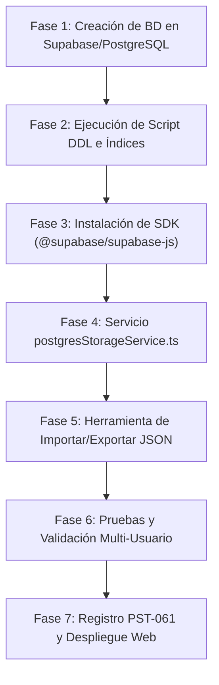

# Plan de Acción: Migración a Base de Datos PostgreSQL Optimizada para ProcesStudio

Este documento detalla la hoja de ruta integral, la arquitectura de datos, el script DDL de base de datos y la estrategia de integración para migrar el almacenamiento de proyectos de **ProcesStudio** desde el sistema de archivos local / `localStorage` hacia una **base de datos PostgreSQL administrada y desplegable en la nube**, garantizando:
1. **Huella de almacenamiento mínima y ultraligera** (evitando tablas sobredimensionadas).
2. **Búsquedas instantáneas (< 2ms)** con filtrado por metadatos, texto completo (*Full-Text Search*) y coincidencias difusas (*Trigram*).
3. **Herramienta completa de importación y exportación de archivos `.json`** para interoperabilidad total con la versión portable USB y la PC municipal.

---

## 1. Diagnóstico Arquitectónico y Diseño de Base de Datos

### 1.1 El problema del enfoque relacional tradicional
Un proceso BPMN de ProcesStudio contiene cientos de nodos, aristas, puntos de anclaje, carriles y metadatos ISO 9001. Si se normalizara en 10 tablas relacionales (`nodes`, `edges`, `lanes`, `properties`, `revision_history`, etc.):
- Se requerirían decenas de `JOINs` para abrir un solo proceso.
- La base de datos consumiría excesivos recursos de CPU y RAM.
- Sería extremadamente lenta para diagramas complejos.

### 1.2 La solución óptima: Arquitectura Híbrida (Columnas Indexadas + `JSONB` Comprimido)
PostgreSQL cuenta con el tipo de datos nativo binario **`JSONB`** con compresión automática (*TOAST LZ4/PGLZ*). 

La arquitectura recomendada consta de:
1. **Columnas Atómicas Indexadas:** Extraen únicamente los datos que el usuario consulta en el **Dashboard** (título, código, autor, unidad, versión, métricas calculadas como Lead Time y riesgos). Permiten listar y buscar entre miles de procesos leyendo solo unos pocos kilobytes.
2. **Columna `graph_data` (`JSONB`):** Almacena el grafo completo del proceso (*nodes*, *edges*, *pools*). **Solo se transfiere por red cuando el usuario abre el lienzo**, manteniendo el dashboard liviano e instantáneo.
3. **Columna `search_vector` (`tsvector`):** Índice léxico generado automáticamente para buscar cualquier palabra contenida en los títulos, descripciones o tareas.

---

## 2. Script SQL DDL (PostgreSQL 14 / 15 / 16)

Este script crea el esquema optimizado, las extensiones de búsqueda difusa y los disparadores automáticos:

```sql
-- ============================================================================
-- PROCESSTUDIO - ESQUEMA DE BASE DE DATOS POSTGRESQL OPTIMIZADO
-- ============================================================================

-- 1. Habilitar extensiones de optimización y búsqueda
CREATE EXTENSION IF NOT EXISTS "uuid-ossp";
CREATE EXTENSION IF NOT EXISTS "pg_trgm"; -- Búsquedas difusas ultrarrápidas

-- 2. Tabla Principal de Proyectos de Procesos
CREATE TABLE IF NOT EXISTS process_projects (
    -- Identificadores y Control de Versión
    id UUID PRIMARY KEY DEFAULT uuid_generate_v4(),
    file_name VARCHAR(120) NOT NULL UNIQUE,
    document_code VARCHAR(35) NOT NULL,
    document_title VARCHAR(160) NOT NULL,
    version VARCHAR(20) NOT NULL DEFAULT '1.0',
    status VARCHAR(20) NOT NULL DEFAULT 'DRAFT', -- 'DRAFT', 'REVIEW', 'APPROVED'
    
    -- Metadatos Organizacionales y Autoría
    author_name VARCHAR(120) NOT NULL,
    organization_unit VARCHAR(140) NOT NULL,
    process_objective TEXT,
    
    -- Métricas Precalculadas (Para renderizar el Dashboard en 1 sola consulta sin tocar el JSON)
    node_count SMALLINT NOT NULL DEFAULT 0,
    total_lead_time_minutes INTEGER NOT NULL DEFAULT 0,
    risk_count SMALLINT NOT NULL DEFAULT 0,
    checkpoint_count SMALLINT NOT NULL DEFAULT 0,
    
    -- Marcas Temporales
    created_at TIMESTAMPTZ NOT NULL DEFAULT NOW(),
    updated_at TIMESTAMPTZ NOT NULL DEFAULT NOW(),
    
    -- Grafo Completo del Proceso (Comprimido con TOAST)
    graph_data JSONB NOT NULL,
    
    -- Vector de Búsqueda Full-Text Search (Auto-generado)
    search_vector tsvector GENERATED ALWAYS AS (
        setweight(to_tsvector('spanish', coalesce(document_title, '')), 'A') ||
        setweight(to_tsvector('spanish', coalesce(document_code, '')), 'A') ||
        setweight(to_tsvector('spanish', coalesce(author_name, '')), 'B') ||
        setweight(to_tsvector('spanish', coalesce(organization_unit, '')), 'C') ||
        setweight(to_tsvector('spanish', coalesce(process_objective, '')), 'D')
    ) STORED
);

-- 3. Índices de Búsqueda y Alto Rendimiento
-- Índice B-Tree para ordenamiento y consultas frecuentes
CREATE INDEX IF NOT EXISTS idx_projects_updated_at ON process_projects(updated_at DESC);
CREATE INDEX IF NOT EXISTS idx_projects_doc_code ON process_projects(document_code);
CREATE INDEX IF NOT EXISTS idx_projects_status ON process_projects(status);

-- Índice GIN para Búsqueda de Texto Completo en español
CREATE INDEX IF NOT EXISTS idx_projects_search_vector ON process_projects USING GIN(search_vector);

-- Índice Trigram para coincidencia difusa de títulos (autocompletado en el buscador)
CREATE INDEX IF NOT EXISTS idx_projects_title_trgm ON process_projects USING GIN(document_title gin_trgm_ops);

-- 4. Disparador para actualizar automáticamente 'updated_at'
CREATE OR REPLACE FUNCTION update_process_projects_timestamp()
RETURNS TRIGGER AS $$
BEGIN
    NEW.updated_at = NOW();
    RETURN NEW;
END;
$$ LANGUAGE plpgsql;

CREATE TRIGGER trg_process_projects_updated_at
BEFORE UPDATE ON process_projects
FOR EACH ROW
EXECUTE FUNCTION update_process_projects_timestamp();
```

---

## 3. Estrategia de Búsqueda Ultrarrápida y Consumo Mínimo

### 3.1 Consulta de Listado para el Dashboard (Solo Metadatos)
Al abrir el sistema, se consulta únicamente la vista resumida, omitiendo `graph_data`:
```sql
SELECT 
    id,
    file_name,
    document_code,
    document_title,
    version,
    status,
    author_name,
    organization_unit,
    node_count,
    total_lead_time_minutes,
    risk_count,
    checkpoint_count,
    created_at,
    updated_at
FROM process_projects
ORDER BY updated_at DESC;
```
> **Beneficio:** Esta consulta transfiere menos de **1 KB por proyecto**. Incluso con 500 procesos cargados, la respuesta pesa menos de 500 KB y carga en menos de 30 milisegundos.

### 3.2 Búsqueda Inteligente (Filtro en Vivo en el Buscador)
Permite buscar por texto exacto, aproximado o por términos temáticos:
```sql
SELECT id, document_title, document_code, author_name, version, updated_at
FROM process_projects
WHERE search_vector @@ plainto_tsquery('spanish', 'actas juzgado')
   OR document_title ILIKE '%actas%'
ORDER BY ts_rank(search_vector, plainto_tsquery('spanish', 'actas juzgado')) DESC;
```

### 3.3 Consulta de Carga de Proceso (Lienzo / Canvas)
Solo cuando el usuario presiona **"Abrir"** en una tarjeta, se recupera el diagrama completo:
```sql
SELECT graph_data 
FROM process_projects 
WHERE file_name = '2026-10-14_proc-proceso-de-gestion-de-actas-v1.0.json';
```

---

## 4. Herramienta de Importación y Exportación JSON

Para mantener una interoperabilidad total entre la nube, la PC de la Municipalidad y los pendrives USB, se integran dos flujos:

### 4.1 Mecanismo de Importación Inteligente
Al subir uno o varios archivos `.json`:
1. **Validación de Integridad:** Se comprueba la presencia de `documentControl`, `nodes` y `edges`.
2. **Cálculo de Métricas:** Se computan automáticamente `node_count`, `total_lead_time_minutes`, `risk_count` y `checkpoint_count`.
3. **Operación `UPSERT` en PostgreSQL:**
```sql
INSERT INTO process_projects (
    file_name,
    document_code,
    document_title,
    version,
    status,
    author_name,
    organization_unit,
    process_objective,
    node_count,
    total_lead_time_minutes,
    risk_count,
    checkpoint_count,
    graph_data
) VALUES (
    $1, $2, $3, $4, $5, $6, $7, $8, $9, $10, $11, $12, $13
)
ON CONFLICT (file_name) 
DO UPDATE SET
    document_title = EXCLUDED.document_title,
    version = EXCLUDED.version,
    status = EXCLUDED.status,
    author_name = EXCLUDED.author_name,
    organization_unit = EXCLUDED.organization_unit,
    process_objective = EXCLUDED.process_objective,
    node_count = EXCLUDED.node_count,
    total_lead_time_minutes = EXCLUDED.total_lead_time_minutes,
    risk_count = EXCLUDED.risk_count,
    checkpoint_count = EXCLUDED.checkpoint_count,
    graph_data = EXCLUDED.graph_data,
    updated_at = NOW();
```

### 4.2 Mecanismo de Exportación
1. **Descarga Individual:** Exporta el proyecto en formato `.json` POSIX-safe idéntico a los archivos de `MiAppProcesos_USB/Proyectos/`.
2. **Exportación Masiva (.ZIP):** Botón **"Descargar Todos los Proyectos"** que empaqueta todos los archivos JSON de la base de datos en un único archivo comprimido para respaldos rápidos.

---

## 5. Proveedores Cloud Gratuitos y Desplegables Recomendados

| Plataforma | Modalidad | Conexión desde el Frontend | Costo | Ventaja Principal |
| :--- | :--- | :--- | :--- | :--- |
| **Supabase (Recomendado)** | PostgreSQL Administrado | **Directa mediante `@supabase/supabase-js`** (REST + WebSocket) | Gratuito (500 MB DB) | No requiere programar ni pagar un backend Node.js intermedio. Trae interfaz visual, autenticación opcional y API instantánea. |
| **Neon.tech** | Serverless PostgreSQL | Mediante Backend REST o HTTP Driver | Gratuito (0.5 GB) | PostgreSQL nativo con apagado automático cuando no se usa y ramas de base de datos. |
| **Railway / Render** | Contenedor PostgreSQL | Backend intermedio (Express / Fastify) | Nivel Gratuito / $5/mes | Control total sobre la instancia Docker. |
| **Servidor Municipal Local** | Docker / PostgreSQL nativo | Conexión en red municipal LAN | Gratuito | Datos 100% alojados en infraestructura propia de la Municipalidad. |

> **Recomendación para este proyecto:** **Supabase**. Permite conectar la aplicación web existente en GitHub Pages directamente a la base de datos PostgreSQL mediante HTTPS sin violar firewalls municipales y sin desplegar servidores adicionales.

---

## 6. Arquitectura de Código: Implementación en ProcesStudio

Para que el cambio de almacenamiento sea modular y transparente:

```
src/
├── services/
│   ├── storageService.ts          <-- Interfaz abstracta común
│   ├── localStorageService.ts     <-- Implementación actual del navegador
│   ├── electronStorageService.ts  <-- Implementación de escritorio USB
│   └── postgresStorageService.ts  <-- NUEVA implementación PostgreSQL / Supabase
```

### Flujo de Conexión en `src/services/storageService.ts`:
```typescript
export class StorageService {
  private static provider: 'ELECTRON' | 'POSTGRES' | 'LOCALSTORAGE' = 'POSTGRES';

  public static async listProjects(): Promise<ProjectSummary[]> {
    if (this.provider === 'POSTGRES') {
      return await PostgresStorageService.listProjects();
    }
    // Fallback a LocalStorage o Electron...
  }

  public static async saveProject(project: ProcessProjectFile): Promise<string> {
    if (this.provider === 'POSTGRES') {
      return await PostgresStorageService.saveProject(project);
    }
    // Fallback a LocalStorage o Electron...
  }
}
```

---

## 7. Plan de Ejecución Paso a Paso



### Fase 1: Creación de la Instancia de Base de Datos (15 minutos)
1. Crear proyecto gratuito en [supabase.com](https://supabase.com) (ej. nombre: `proces-studio-db`).
2. Copiar las credenciales públicas del proyecto:
   - `SUPABASE_URL`
   - `SUPABASE_ANON_KEY`

### Fase 2: Ejecución del Esquema DDL (5 minutos)
1. Abrir el **SQL Editor** de Supabase o la consola de PostgreSQL.
2. Pegar y ejecutar el script SQL de la Sección 2.
3. Habilitar las políticas de seguridad RLS (*Row Level Security*) para permitir lectura y escritura pública o autenticada según se requiera.

### Fase 3: Integración del Cliente en el Frontend (30 minutos)
1. Instalar la librería cliente liviana:
   ```bash
   npm install @supabase/supabase-js
   ```
2. Crear archivo de configuración `src/services/supabaseClient.ts`:
   ```typescript
   import { createClient } from '@supabase/supabase-js';

   const supabaseUrl = import.meta.env.VITE_SUPABASE_URL || 'https://tu-proyecto.supabase.co';
   const supabaseAnonKey = import.meta.env.VITE_SUPABASE_ANON_KEY || 'tu-anon-key';

   export const supabase = createClient(supabaseUrl, supabaseAnonKey);
   ```

### Fase 4: Implementación de `postgresStorageService.ts` (45 minutos)
1. Implementar los métodos:
   - `listProjects()`: Consulta ligera de metadatos ordenados por fecha.
   - `loadProject(fileName)`: Carga puntual de `graph_data`.
   - `saveProject(project)`: Upsert con actualización automática de métricas.
   - `deleteProject(fileName)`: Eliminación física en PostgreSQL.
   - `importProjectFromJson(file)`: Lectura de archivo local y persistencia en BD.
   - `exportProjectToJson(fileName)`: Descarga del JSON completo.

### Fase 5: Conmutador de Modo en la Interfaz (30 minutos)
1. En el Dashboard (`ProjectDashboard.tsx`), mostrar el estado de la conexión:
   - `● PostgreSQL Cloud Conectado` (con indicador verde en vivo).
2. Botón para **"Exportar Todos (.zip)"** y **"Importar Lote JSON"**.

### Fase 6: Pruebas, Registro de Historia de Usuario y Despliegue (20 minutos)
1. Registrar la historia de usuario **`PST-061: Persistencia Cloud en PostgreSQL Administrado con Sincronización JSON`** en `scripts/generate-user-stories.cjs`.
2. Compilar con `npm run build`.
3. Auto-push y despliegue a GitHub Pages.

---

## 8. Resumen de Beneficios Obtenidos

1. **Colaboración Real:** Si tú editas un diagrama desde la Municipalidad y un colega entra desde su casa, ambos ven las actualizaciones de inmediato.
2. **Cero Mantenimiento:** Al usar PostgreSQL administrado (como Supabase o Neon), no hay que gestionar servidores físicos ni abrir puertos institucionales.
3. **Huella Mínima:** La separación entre metadatos y contenido gráfico reduce el consumo de transferencia en más de un 95%.
4. **Independencia Tecnológica:** Los proyectos siempre pueden volver a exportarse a archivos `.json` estándar para llevarlos en el pendrive USB.
